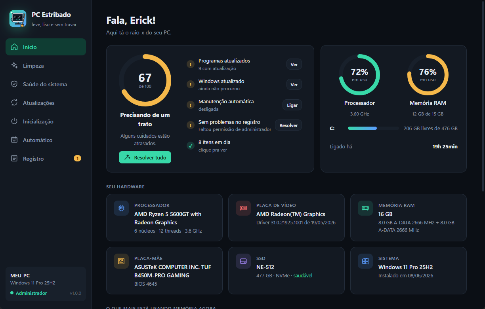
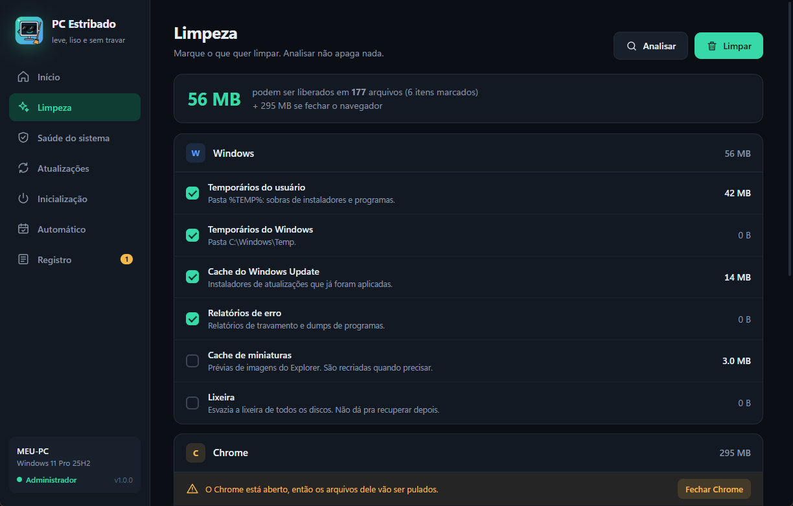
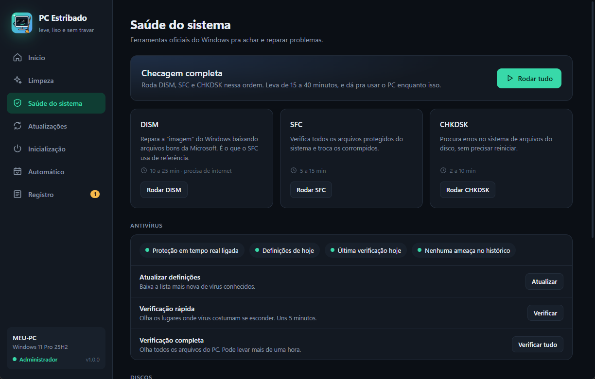
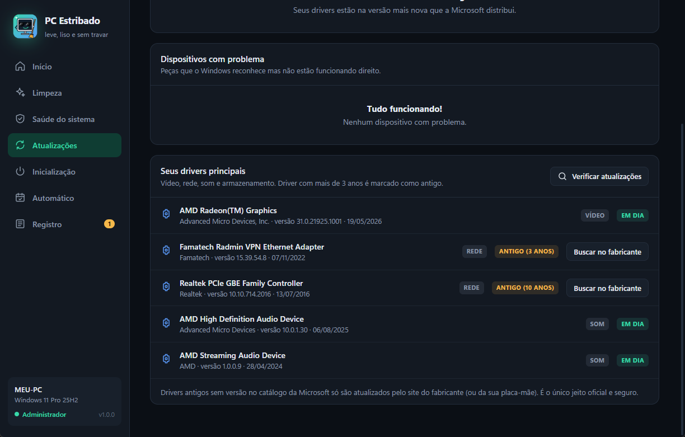

<div align="center">


# PC Estribado

**Limpeza, saúde, drivers e atualizações do Windows numa janela só.**
<br>Leve, liso e sem travar. 😎

[](https://github.com/Erickson45/pc-estribado/releases/latest)
[](https://github.com/Erickson45/pc-estribado/releases)


[](LICENSE)

### [⬇️ Baixar o instalador](https://github.com/Erickson45/pc-estribado/releases/latest)

</div>

---

## A ideia

Todo mundo já passou por isso: o PC fica lento, o disco enche, alguma coisa para de funcionar, e a solução está espalhada em dez comandos de CMD, três telas de Configurações e um programa "limpador" cheio de propaganda.

O **PC Estribado** junta tudo isso num lugar só, com uma interface bonita e em português. Por baixo, ele usa **as ferramentas oficiais do próprio Windows** (SFC, DISM, Windows Update, Defender, winget...) e mostra tudo o que está fazendo, ao vivo.

<div align="center">

</div>

## O que ele faz

### 🏠 Início
- **Nota de saúde de 0 a 100** com o que está pendente e um botão pra resolver cada item.
- **Resolver tudo**: junta todos os reparos pendentes numa tarefa só.
- CPU, RAM e discos **ao vivo**, raio-x do hardware e os programas que mais usam memória.

### 🧹 Limpeza
- Temporários do Windows e do usuário, cache do Windows Update, relatórios de erro, miniaturas e lixeira.
- Cache, histórico e cookies do **Chrome** e do **Edge** (cookies e histórico vêm desmarcados).
- **Limpeza profunda** de componentes antigos do Windows (pasta WinSxS).
- Botão **Analisar**, que mostra quanto vai liberar antes de apagar qualquer coisa.

<div align="center">

</div>

### 🛡️ Saúde do sistema
- **DISM**, **SFC** e **CHKDSK** com a saída ao vivo e barra de progresso.
- **Antivírus**: status do Defender, atualizar definições e verificação rápida ou completa.
- **Discos**: saúde (SMART), temperatura e desgaste, e otimização (TRIM no SSD).
- **Internet**: limpar o cache de DNS e resetar a rede.

<div align="center">

</div>

### 🔄 Atualizações
- **Programas** instalados, pelo winget.
- **Drivers**: dispositivos com problema, drivers antigos, busca no catálogo da Microsoft (inclusive os opcionais) e botão de atualizar cada um.
- **Windows Update** com histórico e aviso de reinicialização pendente. Tudo dentro do programa, sem abrir as Configurações.

<div align="center">

</div>

### ⚡ E mais
- **Inicialização**: liga e desliga o que abre junto com o Windows (do mesmo jeito que o Gerenciador de Tarefas, reversível).
- **Manutenção automática** semanal pelo Agendador de Tarefas. Se o PC estiver desligado na hora, roda quando ligar.
- **Registro** de tudo que foi feito, com botão de copiar e um **diagnóstico** que reconhece erros conhecidos e oferece o reparo.
- **Cancelar** qualquer tarefa no meio.
- **Atualização automática do próprio programa**.

## Segurança em primeiro lugar

Um programa que roda como administrador precisa ser cuidadoso:

- **Nada é apagado sem você ver antes.** Analisar só mostra o tamanho; Limpar sempre pede confirmação.
- **Só ferramentas oficiais do Windows.** Nenhum "otimizador mágico" mexendo no registro.
- **Tudo é reversível** quando dá: a inicialização é ligar/desligar, e as atualizações oferecem ponto de restauração antes.
- **Arquivos em uso são pulados**, e nenhum serviço do Windows é parado à força.
- **Atualização verificada:** o programa só baixa versões novas deste repositório e confere o hash SHA-256 do instalador. Se não bater, ele apaga e não instala.
- **Sem telemetria.** Nada sai do seu PC. O log fica em `%LOCALAPPDATA%\PC Estribado`.

## Instalação

1. Baixe o **`PC Estribado X.Y.Z - Instalador.exe`** na [página de versões](https://github.com/Erickson45/pc-estribado/releases/latest).
2. Rode o instalador. Ele coloca o programa em *Arquivos de Programas* e cria o atalho no menu Iniciar.
3. Pronto. Atualizações futuras aparecem dentro do próprio programa.

> [!NOTE]
> **"O Windows protegeu o computador"?** Isso aparece porque o instalador ainda não tem assinatura digital (um certificado pago). Clique em **Mais informações** e depois em **Executar assim mesmo**. O código está todo aqui pra quem quiser conferir.

**Requisitos:** Windows 10 (1809 ou mais novo) ou Windows 11, 64 bits. O WebView2 já vem no Windows 11 e na maioria dos Windows 10 atualizados.

## Como funciona por dentro

| Peça | Pra quê |
|---|---|
| [Python 3.12](https://www.python.org/) | o programa todo |
| [pywebview](https://pywebview.flowrl.com/) | janela nativa com interface em HTML/CSS (WebView2) |
| [psutil](https://github.com/giampaolo/psutil) | CPU, RAM, discos e processos ao vivo |
| PowerShell, CIM e COM do Windows Update | hardware, drivers, antivírus e atualizações |
| [PyInstaller](https://pyinstaller.org/) + [Inno Setup](https://jrsoftware.org/isinfo.php) | empacotamento e instalador |

```
app.py             janela, ponte com a interface e controle de tarefas (com cancelar)
limpeza.py         alvos de limpeza (Windows, Chrome, Edge)
sistema.py         DISM, SFC, CHKDSK, Defender, discos, rede e reparos
atualizacoes.py    winget, Windows Update e drivers
inicializacao.py   programas que abrem com o Windows
hardware.py        informações e uso ao vivo
automatico.py      manutenção semanal (Agendador de Tarefas)
diagnostico.py     lê o registro e reconhece problemas conhecidos
atualizador.py     atualização automática pelo GitHub Releases
web/index.html     a interface
gerar_icone.py     desenha o mascote, o ícone e as imagens do instalador
```

## Rodando pelo código

```bash
pip install -r requirements.txt
python app.py
```

O programa pede permissão de administrador ao abrir. Pra só olhar a interface, sem admin: `python app.py --sem-admin`.

**Gerar o instalador:** rode `gerar_instalador.bat` (precisa do [Inno Setup 6](https://jrsoftware.org/isdl.php)). O passo a passo pra publicar uma versão nova está em [PUBLICAR.md](PUBLICAR.md).

## Perguntas frequentes

<details>
<summary><b>Meu antivírus reclamou do programa. É vírus?</b></summary>

Não. Programas feitos em Python e empacotados com PyInstaller às vezes são confundidos pelos antivírus, ainda mais quando pedem administrador e apagam arquivos temporários (que é exatamente o trabalho de um limpador). O código está todo aqui no repositório, e cada versão é gerada a partir dele.
</details>

<details>
<summary><b>O CHKDSK deu "acesso negado".</b></summary>

Alguns programas que rodam no núcleo do Windows, como anticheats de jogos (Riot Vanguard, por exemplo), bloqueiam o `chkdsk.exe`. Quando isso acontece, o PC Estribado faz a mesma verificação automaticamente pelo `Repair-Volume`, outro caminho oficial do Windows.
</details>

<details>
<summary><b>Por que alguns drivers antigos não têm botão de atualizar?</b></summary>

O programa só instala drivers do catálogo oficial da Microsoft, que é o caminho seguro. Quando o catálogo não tem versão mais nova (comum em placas de rede e som antigas), aparece o botão **Buscar no fabricante**, porque nesse caso o único lugar confiável é o site do fabricante do componente ou da placa-mãe.
</details>

<details>
<summary><b>Ele deixa o PC mais rápido?</b></summary>

Liberar espaço e manter o sistema íntegro e atualizado ajuda bastante, mas o que mais pesa no dia a dia costuma ser o que abre junto com o Windows. Por isso a tela de **Inicialização** e a nota de saúde dão tanto destaque a isso. Nenhum programa sério faz milagre, e o PC Estribado não promete.
</details>

## Licença

[MIT](LICENSE). Pode usar, estudar, modificar e distribuir, mantendo os créditos.

<div align="center">
<br>
Feito por <a href="https://github.com/Erickson45">Erickson Queiroz</a> 🤙
</div>
